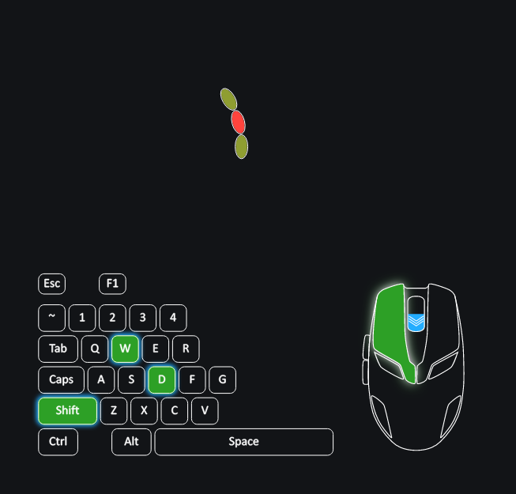
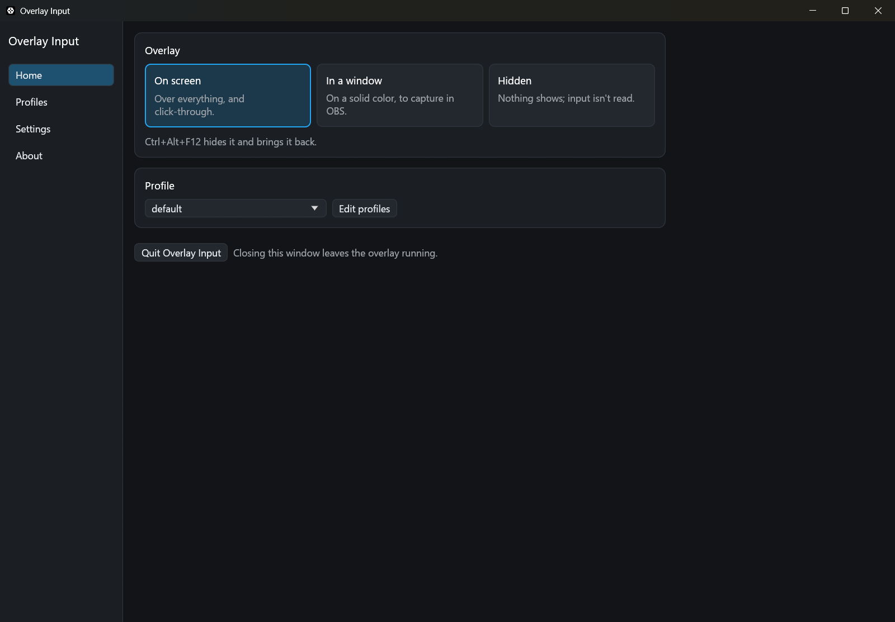
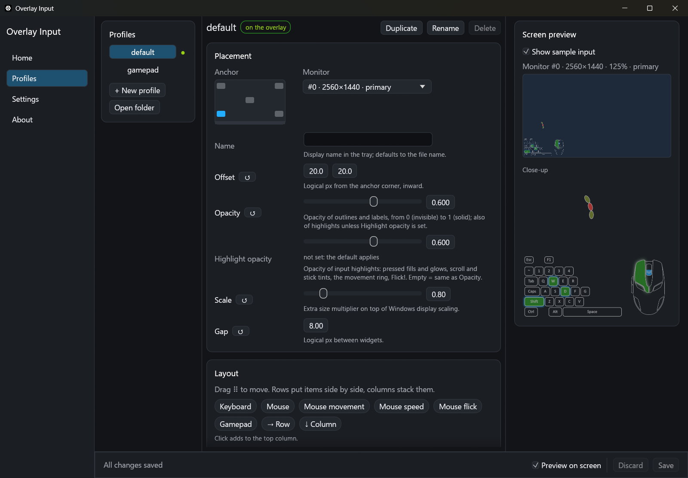

# Overlay Input

Show your keyboard, mouse and gamepad input on top of any app or game.

[](https://github.com/m51v5/overlay-input/actions/workflows/ci.yml)
[](LICENSE)
[](#download)



Overlay Input is a transparent, click-through overlay for Windows. It's a single native exe: no browser, no installer, and you don't need OBS to use it.

## Features

- **Widgets:** keyboard, mouse, mouse movement ring, mouse speed, flick indicator, Xbox and DualSense gamepads.
- **Works in games:** reads input while the game has focus. No input hooks, no injection.
- **Stays out of the way:** always on top, with no background, and clicks go straight through it. Opacity is adjustable, separately for outlines and for what you press.
- **Profiles:** arrange widgets by drag and drop with a live preview, or edit a small TOML file. Saved changes apply at once.
- **Ready for OBS:** show it on screen, in a window for a color key, or on screen but left out of recordings.
- **Light:** about 8 MB on disk, about 30 MB of RAM, and no CPU use while nothing changes. The app window is a separate process of about 90 MB that exists only while it's open.

| Home | Profiles |
|---|---|
|  |  |

## Download

1. Get the latest zip from [Releases](https://github.com/m51v5/overlay-input/releases/latest).
2. Unzip it into its own folder. Profiles and settings are created next to the exe.
3. Run `overlay_input.exe`.

Windows 10 or 11 is required. The exe isn't code-signed, so Windows SmartScreen may warn you the first time: choose **More info**, then **Run anyway**.

## Quick start

1. Start `overlay_input.exe`. The overlay appears at the bottom left, and the app window opens on the first run.
2. On **Home**, choose where the overlay shows and which profile it uses.
3. On **Profiles**, move it, resize it, and pick its widgets. Press **Save** when you're done.
4. Close the window. The overlay keeps running in the tray: double-click the tray icon to reopen the window, and press `Ctrl+Alt+F12` to hide or show the overlay.

## Privacy

Overlay Input only draws your input. It has no network code, sends nothing anywhere, and doesn't save what you type. Details are in [SECURITY.md](SECURITY.md).

## Documentation

- [Usage guide](docs/USAGE.md): the app window, profile files, every widget option, OBS setup, and known limits.
- [Development guide](docs/DEVELOPMENT.md): running from source, tests, stack, and architecture.

## Build from source

You need [Rust](https://rustup.rs) 1.95 or newer.

```
git clone https://github.com/m51v5/overlay-input.git
cd overlay-input
cargo run --release
```

## Contributing and support

- Found a bug or have an idea? [Open an issue](https://github.com/m51v5/overlay-input/issues/new/choose).
- Want to help? Read the [contributing guide](CONTRIBUTING.md) and the [code of conduct](https://github.com/m51v5/.github/blob/main/CODE_OF_CONDUCT.md).
- Found a security problem? See [SECURITY.md](SECURITY.md).

## License

[MIT](LICENSE) © [@m51v5](https://m51v5.com)
