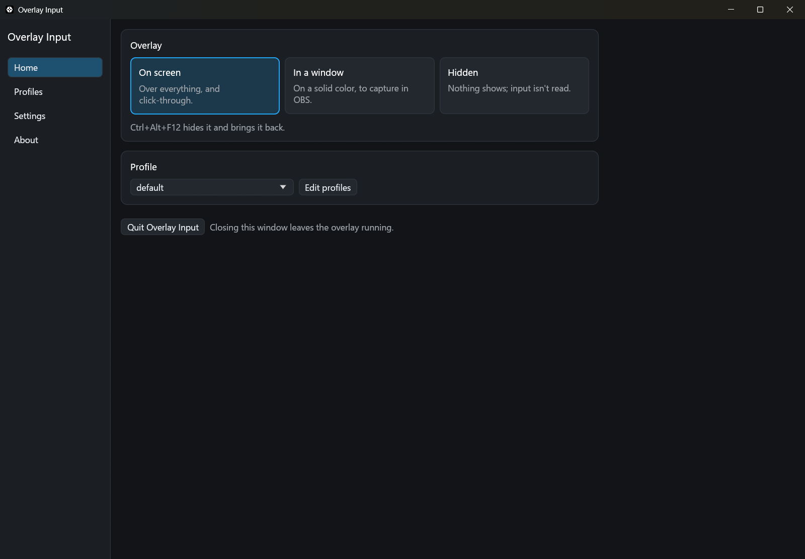
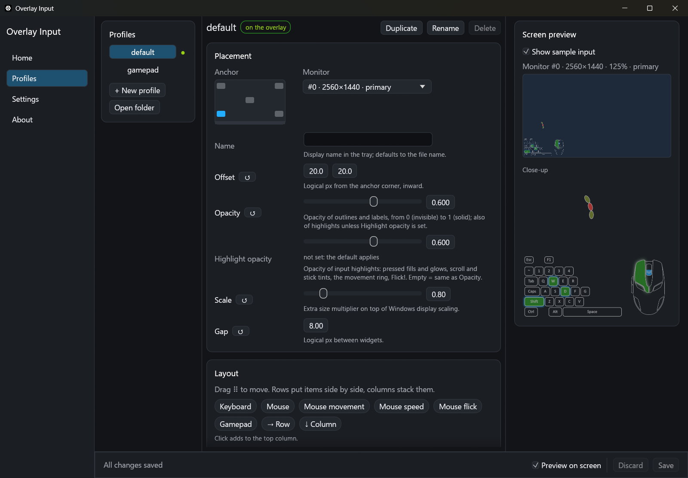
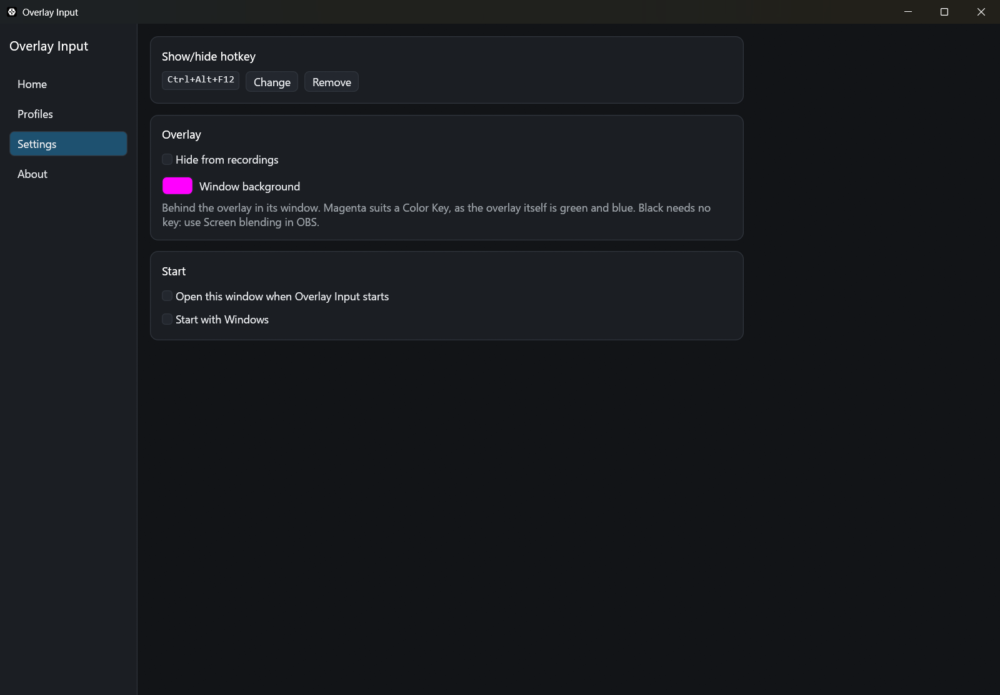

# Usage guide

- [First run](#first-run)
- [The app window](#the-app-window)
- [The tray icon](#the-tray-icon)
- [Using it with OBS](#using-it-with-obs)
- [Profile files](#profile-files)
- [Widgets](#widgets)
- [Limits](#limits)

---

## First run

Put `overlay_input.exe` in its own folder and run it. The app window opens by itself the first time, and these are created next to the exe:

| Created | What it's for |
|---|---|
| `profiles/` | Your overlay layouts, starting with `default` (movement ring above keyboard and mouse) and `gamepad` |
| `settings.toml` | The show/hide hotkey and the start option |
| `state.toml` | What the app remembers: last profile, where the overlay shows, window size and background |
| `logs/` | One file per day (`overlay_input-YYYY-MM-DD.log`), the last 30 days kept. Only warnings and errors are logged; each line has the local time and its UTC offset, e.g. `2026-10-14 21:44:28.820 +03:00` |

The exe is all you need; the zip's `LICENSE` and `THIRD_PARTY_LICENSES.txt` are there for reference. Every start puts back whatever is missing: `settings.toml`, `state.toml` and `profiles/default.toml`. Example profiles you delete stay deleted, and nothing that exists is ever overwritten.

**Later starts:** Overlay Input starts in the tray and shows the last profile you used, else `default.toml`. To open the window at every start, tick **Open this window when Overlay Input starts** on the Settings page. To open it once from the command line, use `overlay_input.exe --window`.

**One copy at a time:** starting it again opens the running copy's window.

**If `default.toml` has a mistake** when it's needed at start, a warning shows the error and asks what to do:

- **Yes** saves your file as `default.toml.bak` (or `.bak-2`, ...) and replaces it with the original default.
- **No** closes Overlay Input so you can fix the file.

---

## The app window

Double-click the tray icon to open it, or use the icon's **Open** item. Closing the window leaves the overlay running.

### Home



Picks where the overlay shows:

| Choice | What it does |
|---|---|
| On screen | The overlay on your screen, over everything (default) |
| In a window | The overlay in a normal window instead, for OBS (see [Using it with OBS](#using-it-with-obs)) |
| Hidden | Nothing shows, and *all input capture stops* |

Home also picks the profile on the overlay, and has **Quit Overlay Input**, which asks first if you have unsaved changes.

### Profiles



Make profiles without writing TOML:

- **Profiles:** create, duplicate, rename and delete profiles, choose which one is on the overlay, and open the profiles folder.
- **Placement:** pick the corner on a mini screen, then set offset, opacity, size, gap and monitor.
- **Layout:** drag widgets from the palette into rows and columns, or click a widget to add it. Move items with the ⠿ handle or ↑ ↓, and align them. Click a widget to open its options. Colors use a color picker, and gradients are stops on a bar.
- **Keyboard keys:** click keys on a picture of the keyboard to hide or show them. "Hide all" followed by a few clicks gives you, for example, only WASD.
- **Previews:** while you edit, the real overlay shows your unsaved changes; turn that off with "Preview on screen". If the window is wide enough, it also shows a scaled copy of the target monitor with the overlay in place, and a close-up drawn by the overlay's own renderer. "Show sample input" lights up some keys, buttons and a stick so you can judge colors and glow.

Nothing is written until **Save** (or Ctrl+S). Discard, or closing the window, puts the saved profile back; with unsaved changes, closing asks first.

Saving rewrites the profile file, so comments you typed by hand in that file are not kept.

### Settings



- **Show/hide hotkey:** `Ctrl+Alt+F12` by default. Press **Change**, then the new keys; it applies at once. You can also edit `settings.toml` and restart.
- **Hide from recordings:** with the overlay on screen, you see it, but screen recordings and screenshots don't.
- **Window background:** the color behind the overlay in its window.
- **Open this window when Overlay Input starts**
- **Start with Windows:** adds Overlay Input to your Windows startup apps. If you move the exe, tick it again.

### About

Shows the version, and links to:

- **Project:** what's new, the source code, the privacy notes and the license.
- **Help:** report a problem on GitHub, with your version already filled in, or open the logs folder.
- **Made by:** the author's site, Telegram and other platforms.

---

## The tray icon

Right-click for the menu:

| Item | What it does |
|---|---|
| Open | Opens the app window, or brings it to the front |
| Profile ▸ | Switches the active profile |
| Hide / Show | Hides the overlay and *stops all input capture*, or brings it back where it was |
| Quit | Exits, asking first if the window has unsaved changes |

Double-click the icon to open the app window.

When a profile's `name` differs from its file name, the tray shows both, e.g. `FPS (fps copy)`, so two profiles with the same `name` stay apart.

---

## Using it with OBS

**On your screen and in OBS:** choose On screen. OBS Display Capture already shows it.

**Only on your screen:** also tick **Hide from recordings** on the Settings page. Display Capture, screenshots and screen sharing then leave the overlay out.

**Only in OBS:**

1. On Home, choose **In a window**. The overlay moves from your screen to a window, on magenta. Resize it and the overlay redraws sharp at that size.
2. In OBS, add **Window Capture**, pick `Overlay Input — Window`, and set the capture method to **Windows 10 (1903 and up)**.
3. Right-click the source → **Filters** → add **Color Key** with key color magenta, or **Chroma Key** for softer edges.
4. Put the window behind your game or on another monitor. Don't minimize it: Windows stops drawing minimized windows.

**Background color** (Settings page, or Home while the window is showing): magenta is the default because pressed keys and the movement ring are green, which a green key would cut out. Any color works if your key filter matches it. Black needs no key filter: set the source's blending mode to **Screen** (right-click → Blending Mode). Glows then look right, and the dark key fills disappear.

The window draws at full opacity, so use OBS's own opacity setting. Closing it hides the overlay. The hotkey hides it and brings it back where it was, and the next start shows it where it was, at the same window size.

---

## Profile files

Each `.toml` file in `profiles/` is one overlay layout. Use the Profiles page, or write the file by hand. Saving the file applies it immediately. If you save a file with a mistake, the error goes to the log and the current layout stays on screen.

```toml
name = "FPS"
anchor = "bottom-left"   # top-left | top-right | bottom-left | bottom-right | center
offset = [20, 20]        # px from the anchor corner, inward
opacity = 0.6            # 0.0 .. 1.0, outlines and labels
highlight_opacity = 1.0  # optional: pressed keys/buttons, glows, ring; default = opacity
scale = 0.8              # on top of Windows display scaling
monitor = 0              # 0 = primary, then left to right
gap = 8                  # px between widgets

[layout]
column = [
  { widget = "mouse-movement", radius = 150, elements = 24, element_size = [36, 18] },
  { row = [
      { widget = "keyboard", preset = "default" },
      { widget = "mouse" },
  ], align = "end" },
]
```

`row` places items side by side, `column` stacks them, and both nest. `align` (`start` / `center` / `end`) lines items up across the row or column.

---

## Widgets

All options are optional.

| Widget | Shows | Options |
|---|---|---|
| `keyboard` | Keys light green with a blue glow while held, fade on release | `preset = "default"` (gaming cluster) or `"full"` (whole keyboard + numpad); `hidden_keys`, `hide_mode` (see below) |
| `mouse` | Buttons light up; wheel arrows animate; scrolling lights the wheel half in blue | `scroll_highlight`, `scroll_color` |
| `mouse-movement` | Ring that lights up in the direction the mouse moves | `radius`, `padding`, `elements`, `element_size`, `fade_factor`, `speed_factor`, `affected_neighbours`, `neighbour_fade_factor`, `gradient` |
| `mouse-speed` | Live speed, e.g. `12.34 inch/sec` | `cpi`, `refresh_ms`, `decimals`, `units`, `multiplier`, `font_size`, `gradient` |
| `mouse-flick` | "Flick!" on a fast horizontal flick | `interval_ms`, `threshold`, `display_ms`, `fade_ms`, `text`, `font_size`, `color`, `glow_color`, `glow_blur` |
| `gamepad` | Xbox or DualSense: buttons, sticks (blue while pushed), triggers, D-pad | `style = "xbox" \| "dualsense"`, `source = "auto" \| "xinput" \| "dualsense"`, `index`, `width`, `stick_highlight`, `stick_color` |

**Showing only some keys:** list the keys to leave out in `hidden_keys`, by key name, for example `hidden_keys = ["Escape", "F1", "Tab", "CapsLock"]`. Names look like `KeyW`, `Digit1`, `ShiftLeft`, `Space` or `Numpad7`; the clickable keyboard on the Profiles page writes them for you. `hide_mode` sets what the hidden keys leave behind:

- `crop` (default): shown keys stay in place, and the widget shrinks to fit them.
- `keep`: the widget keeps the whole keyboard's size, and hidden keys leave holes.
- `collapse`: shown keys slide left to close the holes, and empty rows are removed.

A `gradient` is a list of stops, for example: `gradient = [{ at = 0.0, rgb = [45, 100, 38], opacity = 0.0 }, { at = 1.0, rgb = [255, 61, 61] }]`.

---

## Limits

- **Exclusive fullscreen games** draw over every overlay. Use borderless or windowed mode.
- **Games running as administrator:** Windows won't deliver their input to a non-admin app. Run Overlay Input as administrator for those games. The log names the game when this happens.
- **DualSense:** one pad at a time via USB or Bluetooth. Through Steam Input or DS4Windows it shows up as an Xbox (XInput) pad instead.
- **Text** uses grayscale anti-aliasing. A transparent overlay can't show ClearType's colored edges.
